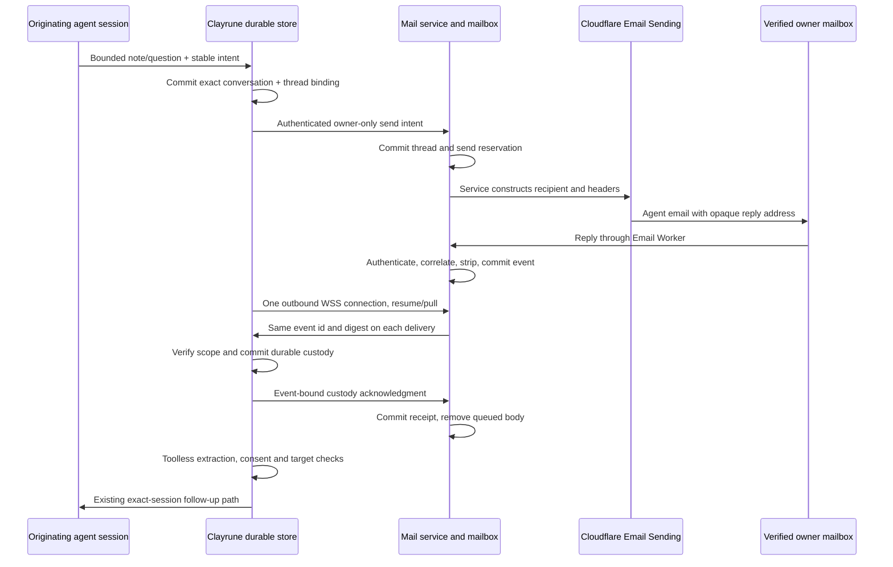

# Agent mail: outbound connection and durable pull

MC-1166. Author: Sol_Tobin. Source snapshot: `bbe78dc8`, 2026-11-11.
Status: **design proposal for Dave; no implementation, deployment or configuration
change is authorized by this document.** Recommendations below are not decisions.

## Authority and scope

Ron selected pull on 2026-11-11: one outbound Durable Object WebSocket per
installation; the installation collects its mailbox and acknowledges only after
durable local storage. Clayrune verifies the private owner mailbox with its own
link. The service assigns the `@clayrune.io` address. Outbound uses Cloudflare
Email Sending and goes only to the verified owner. No tunnel, remote-access
control plane (CP), device enrollment, CP ceremony, Access token, or Cloudflare
verified-destination list participates in mail.

This supersedes the tunnel/CP portions of [the original spec](AGENT_MAIL_SPEC.md),
[transport](AGENT_MAIL_TRANSPORT.md), unit-7 delivery/ceremony contracts and
[signup readiness](AGENT_MAIL_SIGNUP_READINESS.md), **as a target architecture**.
Their source remains the current implementation. It does not supersede the
spec's binding **Owner and address change: abuse controls** section, exact-session
continuation, toolless extraction, consent, deletion, or human-only gates. Older
standing-position wording about tunnel ingress is superseded only on transport.

All paths, payloads, new modules and limits described as proposed are unbuilt.
Existing defaults are labeled separately. P1-P7 are decisions for Dave; build
units depending on them wait for his recorded selection. There is no silent
conditional choice by the builder.

## Service boundary and portability

The installation's sole service-location setting is
`agent_mail_service_origin`, an exact HTTPS origin. Derive HTTPS endpoints and
the WSS upgrade from it; reject redirects, cross-origin URLs, downgraded schemes
and response-selected hosts. No Cloudflare account ids, D1/DO ids, domain
management tokens, CP issuer or tunnel URLs belong in the client contract.
Public trust material and the install's own identity are credentials/state, not
additional service locations. P3 decides whether to retain the existing signed
service manifest; it is mail-service trust and is not a CP dependency.

The service owns addresses, routing and provider adaptation. A later GCP service
plus a receiving provider can implement the same versioned HTTPS/WSS protocol.
Moving compute behind the same origin preserves client configuration. Changing
the origin requires a human-authorized trust/identity migration; never follow an
unsigned relocation instruction or forward credentials to a redirect. Address
ownership and DNS/MX migration are service operations, not client concerns.

One connection means one long-lived receive connection per install, shared by
all projects/agents. Bounded HTTPS signup, send, status and revocation requests
are allowed; neither a dashboard tab nor one socket per conversation is needed.
The server owns the receive loop. Closing the UI leaves it running; closing or
suspending Clayrune leaves mail at the service within the retention window.

## Message flows

**Outbound:** derive recipient from the active server registration, never client
`to`, CC/BCC, MIME, From, Reply-To or another installation id. Persist local
intent and immutable project/session/native-conversation/permissions binding
before sending. Service commits thread/token verifier and stable Message-ID
before provider submission. Use the same intent id and body digest on retry;
conflicting reuse is refused. Accepted means transport accepted, not inbox
delivery or read. A timeout after possible provider acceptance is `uncertain`;
reconcile using positive evidence, never blindly send again. Provider suppression,
bounce and quota errors become visible status. A service-controlled opaque base
address plus per-thread secret token retains D2's syntax; unthreaded mail does
not create or select an agent. The service may use a fixed domain sender with
the assigned address in Reply-To; per-install From is not required by this change.

**Inbound:** Email Worker remains the sole public mail ingress. Preserve the
existing exact verified From + secret thread token + registered outbound
Message-ID + trusted Cloudflare DMARC/alignment checks, loop/bounce suppression,
ordered headers and conservative MIME stripper. Sender-supplied authentication
headers are not proof. Check active registration/owner generation before and
inside durable enqueue. Keep only bounded stripped text or a content-free hold,
never attachments/raw MIME/hidden HTML. Real provider fixtures remain a launch
gate; a WebSocket does not repair unverified sender provenance.

After local custody, reuse `agent_mail_launder`, `agent_mail_extract`,
`agent_mail_wake`, `agent_mail_target`, `agent_mail_continuation` and
`agent_mail_pipe`. The existing follow-up route is the only execution path.
Hold on missing native history, explicit closure/deletion, wrong project or
owner generation, busy session, uncertain provider acceptance, unavailable
verified extractor or quota pressure. Preserve question/revision matching and
late-reply semantics. Mail content stays labeled untrusted and cannot click
publish/passcode/credential gates. No character-name or default-agent fallback.

## Mailbox, custody, retention and offline behavior

P1 recommendation: keep D1 as the durable authority for registrations, threads,
events and receipts; a per-install hibernating DO owns only socket coordination.
This retains transactional generation checks and the existing ledger, without
making DO memory or a notification the queue. Alternative P1 places mailbox
payloads/state in DO SQLite and requires a cross-store enrollment/revocation
protocol. The following candidate flow assumes P1's D1 option, not its approval.

An enqueue transaction writes event, dedupe record and notification intent.
Only after that commit may SMTP processing report acceptance. Attempt a bounded
DO notification; a lost notification is harmless to custody. An indexed scheduled
sweeper retries durable notification intents and expiry work, and connect/resume
queries the authoritative pending set. Never rely solely on `waitUntil`, an
email invocation's lifetime, DO memory or an in-memory timer. Start with bounded
one-minute sweep batches; monitor oldest intent age and backlog, not just a
healthy scheduler. Pagination must resume until due work is drained fairly.

Per-install event identity includes registration generation, thread and incoming
Message-ID; equal text in distinct messages is not duplication. Changed content
under the same identity is a conflict, not an update. The mailbox assigns a
monotonic sequence for paging, but the client acks individual event ids/digests,
never an unproven high-water mark. Preserve ordering within each originating
conversation; one held conversation must not starve another.

The install commits event content/hold, immutable local thread mapping, dedupe
receipt and pending acknowledgment together in the checked local SQLite store
outside the repo. Do not acknowledge a refused insert, failed fsync/commit,
unknown thread, expired event or corrupt/missing store. Ack binds install,
registration/owner generation, event id and digest. The service atomically
records custody and removes its queued body only if that exact event still
belongs to the active generation. Duplicate identical ack returns the same
receipt; conflicting/foreign ack fails. A lost ack causes redelivery of the same
event, local deduplication and re-ack, without a second follow-up.

Service queue state: `pending -> offered -> local_received`; offer leases expire
back to pending. Side states: `held`, `expired`, `revoked`. Local state continues
`local_received -> laundering -> ready -> submitting -> submitted ->
turn_completed`, with current retry/blocked/uncertain branches. Custody ack,
provider acceptance, turn completion and requested-action completion are four
different facts. A model failure after ack is local held work, not lost cloud mail.

Preserve existing D4 retention baseline: 30-day offline/held queue, 90-day thread
validity, delete cloud bodies upon custody, 30-day terminal metadata. Local
terminal transitions purge content; submitted events retain content until
completion/one-day completion timeout, with separate revocation-purge backstops.
`mark_submitted()` alone does not purge it. Verify these behaviors after adaptation.
Queue expiry remains absolute from receipt across redelivery/restart; local
receipt must not grant a fresh 30 days. Expired and rejected work stays visible
as bounded reason/count metadata. Never advertise delivery after the retention
window or successful agent handling based on custody alone.

**Correction needed in this baseline (P4):** a 30-day terminal tombstone can
expire while the corresponding 90-day thread still accepts redelivery. Recommend
content-free dedupe evidence through thread expiry plus 30 days, while retaining
ordinary terminal detail for 30 days. Alternative: expire reply tokens at 30
days too. Until selected and tested, do not claim dedupe for the full thread
lifetime. A receipt merely covering the current envelope's expiry is insufficient
against a newly delivered SMTP copy of the same old Message-ID.

Disable blocks new sends and local submissions immediately under the existing
serialized consent boundary, even offline. Queue a remote revoke; the UI says
`off locally / revocation pending` until authenticated service receipt. On service
revoke: reject sends/receipts for the old generation, close its socket, retire
threads and discard queued execution content under disclosed deletion policy.
Re-enable requires fresh human consent and generation; never replay the old
generation. Already submitted turns/sent mail cannot be recalled.

On local disk loss/corruption, preserve `MailFactory` marker/seal refusal: never
silently create an empty inbox and ack cloud mail. If cloud custody already
ended, restoring the disk is a local backup/recovery matter; the service is not
a permanent backup. Remote deletion is explicit and retried durably. Normal
expiry/deletion must also disclose provider backup windows (D1 Time Travel is
30 days on Paid); do not claim immediate physical deletion from backups.

## Install authentication and vault custody

Preserve the existing separate mail Ed25519 identity, not the remote-access
device key. P2 is the new socket handshake choice, not a reopening of that
mail-key separation. Human opt-in creates a random mail identity and public key; the
service registers that key only through the verified mailbox enrollment flow.
Knowledge of an install id/address does not authenticate. Each privileged HTTPS
request proves possession with purpose, version, exact origin/method/path,
install id, generation, key id, body digest, timestamp and unique nonce. Replay
claims are durable and atomic; wrong key, clock skew, stale generation and
cross-origin/cross-purpose reuse fail before side effects.

For WSS, obtain a short-lived single-use upgrade ticket via signed HTTPS, then
send it in an authorization header on the exact same-origin upgrade (never a
query string, cookie, log or long-lived bearer). Bind it to install, generation,
key and protocol version; consume atomically. The DO restores only these bounded
bindings and a connection epoch in socket attachment state after hibernation.
Only one current connection epoch is eligible to receive for an install; a new
authenticated connection fences/closes the previous one, which cannot ack a
different event or generation. A ticket cannot send email or change owners.
Recheck durable consent/generation on send, fetch and ack; a cached live socket
is never permanent authorization. Ticket lifetime (candidate 60 seconds) and
connection reauthentication horizon (candidate 24 hours) are part of P2.

Application frames have a version, type, bounded length and explicit scope.
Proposed types: `resume`, `event`, `custody_ack`, `ack_committed`, `status`,
`hold`, `reauth_required`. Unknown types/fields and remote executable targets
are refused. Reconnection always reconciles durable events and ack outbox; socket
position alone is not a receipt. P3 decides whether envelopes and service
responses additionally use existing root-verified service signatures or only
authenticated TLS. New signature directions/frame transcripts need cross-language
test vectors; never reinterpret old tunnel-path signatures as WSS proofs.

Use existing `mc/secrets_store.py::peek_passphrase_key` and
`agent_mail_enrollment_keys.py::IdentitySeal`: AES-GCM identity sealed with the
existing unlocked vault key, bound by AAD to identity/generation/key id. The
mail seed never leaves that module or appears in HTTP, repo files, command
arguments, transcripts or status. Current seal contains a seed plus independent
flow secret; remove unused flow-secret semantics only in a versioned migration.
No agent-facing vault create/write, automatic vault setup or unlock is added.
Human key creation occurs inside the authorized local enrollment action.

With a locked vault the client cannot sign reconnect/send: show `vault_locked`
and leave cloud mail queued. Existing in-memory credentials must obey vault-lock
semantics, not silently maintain new signing capability; close the receive
session on lock and retry only after authorized unlock. Preserve the existing
separate cancellation-only fence capability (`lifecycle_fence.py`): it can revoke
or cancel with a lost/locked vault and cannot send/read/change owner. Its
availability outside the sealed key is intentional existing behavior, not a new
general mail credential. No mail-only master key is introduced to make unattended
mail work. Disclose this availability limit during signup.

Normal rotation proves old and new key possession, commits a new key/generation,
then fences the old socket/tickets. P5 governs total key loss: recommend verified
owner recovery plus local human gate, with fresh identity/generation and no
automatic revival of old threads. Until selected, missing seal stays held and
there is no inferred ownership recovery. Copying an install's sealed identity
does not create another legitimate installation; concurrent clones contend for
one connection and should surface a conflict, not multiply owner quotas.

## Signup, owner change and address lifecycle

Signup starts only at explicit human opt-in through the existing passcode and
human-attribution gates. No mail address transmission on GET/status or decline.
Persist consent/disclosure version, stable random mail install id (separate from
anonymous ping), sealed identity, flow id, pending ack/revoke state and server
assignment. Server returns its opaque reserved address and pending request id;
only the verified commit makes it operational. No install can request another
install's address or choose its owner by editing local state.

The service sends a fixed verification template to the proposed private owner.
Store a hash of a high-entropy one-use link token scoped to request, install,
public key, owner and expiry. GET displays an inert confirmation page without
activation; a CSRF-protected explicit POST consumes the token, confirming the
exact request. Do not put agent text or attacker-selected links in this page or
template; redact token from access/referrer/analytics logs. Flow-secret/key proof
binds the pending request to the originating install. Link confirmation need not
contact the install, so it works while offline; activation is learned via an
authenticated status/reconnect. Duplicate confirm is a no-op with no new mail.

The service atomically enforces address reservations, owner install count and
verification budgets across all installs. Concurrent confirmations cannot exceed
the same owner's 3-active-install limit. Reserve owner quota with expiring pending
claims to avoid oversubscription, but do not count unconfirmed installs as active.
Canonicalize mailbox identity conservatively using existing parsing; do not
guess provider-specific dot/plus equivalence or case-fold local parts. Pending
requests expire after 30 minutes and receive no operational send/reply privileges.

The spec's binding owner/address controls are copied here as acceptance facts:

| Required control | Pull implementation obligation |
| --- | --- |
| Human-only, passcode-gated change | No agent tool/route can start, confirm or cancel a change; typed UI action starts the local flow. Hosted token-confirmation POST proves mailbox control within that already-authorized flow, never generic agent authority. |
| New owner's single-use confirmation | POST confirmation activates only the bound request; 30-minute expiry, scanner GET inert, repeated confirm no-op. Current owner keeps privileges while pending. |
| Old-owner notice and 7-day revert | At switch, durably enqueue a fixed notice with a scoped freeze/revert token. Its use freezes mail and restores the old owner under a fresh generation; never release old queued instructions. Retry notice via durable outbox and show delivery failure. |
| Verification spam control | At most 3 verification emails/install/day and 3/target address/day across installs; fixed subject/body/links, no agent-controlled content. Count attempted reservations before provider work so races/retries cannot bypass limits. |
| Change frequency | At most 1 completed change/7 days and 5/year/install, durable across disabled/re-enrolled flows; switching a local id cannot evade the owner-address global budgets. |
| No thread reassignment | Increment owner/registration generation atomically at switch, close old socket/tickets, revoke old threads and old-generation pending events. Old address cannot reply; new address cannot inherit old threads. |
| Address quarantine | Renamed/deleted names unavailable to other owners for 90 days; reuse never inherits threads, tokens or queued mail. Service assignment is opaque, not user-selected. |
| At most 3 active installs/owner | Server transaction, not UI check; each install needs its own mailbox confirmation. Store enough minimal suppression/reservation evidence to enforce this after deletion without retaining content. |
| Observable changes and refusals | Bounded service audit plus authenticated Settings projection: change, revert, rate-limit, pending notice and revoke outcomes; no raw bodies, private keys or link tokens. |

P7 remains open on proving the human management context at the service: a
modified client can sign a request claiming that its local passcode was checked.
Ordinary mail keys and WSS tickets must not authorize owner changes. Recommend a
separate, short-lived hosted owner-management session obtained by an old-owner
mailbox link, alongside the local passcode gate; an enrolled WebAuthn step-up is
an alternative with more setup/recovery work. Management session/capability never
enters agent context, general send APIs or the receive loop. After initiating a
bound change in that session, the new owner's separate confirmation and old
owner's notice/revert still apply exactly. Additional step-up mail uses the same
fixed templates and verification budgets, never an unlimited authentication-mail
loophole. Lost old mailbox is recovery, not an excuse to waive step-up.
For the recommended session, use Secure/HttpOnly/SameSite cookies restricted to
the management surface, CSRF protection and a candidate 10-minute expiry; no
agent-readable token export. P7's contract freeze must review these details and
the separation from ordinary installation-auth routes before building them.

Owner switch and notice enqueue must be one durable transaction. A crash cannot
activate the replacement while forgetting to notify the old owner. Freeze/revert
is denial/recovery-only, not an ability to send arbitrary mail. Serialize owner
change with send reservations; an already handed-off provider send cannot be
recalled, but no later send may select the old owner. Expire unsubmitted old-owner
intents. Signing ordinary send/status requests never grants owner-change rights.

No CP identity is replaced by a disguised CP: service registration is only a
mailbox/public-key/consent relationship. Mailbox possession does not establish
remote-access entitlement. Human-service recovery must not create vault secrets,
pair tunnels or relax passcodes.

## Limits, disconnect and recovery

Current Worker defaults in `ledger.js`: 20 sends/install/day, 1,000 sends/global/day;
200 accepted inbound/install/day, 10,000/global/day; 100 queued bodies/install,
10,000/global; 30-day queue, 90-day threads. Current local `MailStoreConfig`
allows 600 active events, 64 KiB custody body, 16 KiB extracted reply and 8
attempts; the Worker caps raw MIME at 64 KiB and stripped text at 16 KiB.
These are different limits, not evidence of support at 10,000 installs.

Keep owner-change limits above exactly. P6 must approve operational scale caps:
recommend retain 20 normal sends/install/day and 200 accepted inbound/install/day,
100 cloud queued events/install plus a byte cap, 600 local events, and the present
body bounds; scale aggregate caps in measured rollout stages. Verification/notice
sends have separate fixed-template budgets plus the global spend breaker.
Rate-limit unauthenticated signup/connect before crypto/DB work by trusted edge
source, and enforce target-address/global budgets durably. Do not charge a forged
install id against that install's valid-auth allowance. Add per-key connect/frame
budgets, bounded offers (candidate 10 events/128 KiB), ack timeout, per-conversation
fairness, model-work caps and finite retry/backoff. Return closed reason codes
and Retry-After, not raw remote exception text.

Disconnect, sleep, deploy, service outage or heartbeat timeout retains every
unacked event. Client retries with exponential full jitter (candidate 1 second
to 5 minutes) and resets only after a stable connection; honor Retry-After.
Authentication failure, revoked generation, vault lock and corrupt state are
holds requiring the corresponding repair, not tight retry loops. Failed TLS or
wrong origin never downgrades to HTTP, tunnel callbacks or polling another host.

Use DO hibernation `acceptWebSocket`, reconstruct scope from socket attachments,
and query durable authority after waking. No `setInterval`, per-install empty
poll or pending long-lived I/O that prevents hibernation. Prefer protocol ping/
pong for liveness; if application auto-response is needed, prove hibernation and
account for incoming frame billing. A reconnect storm is limited/jittered,
and a new connection never resets rate buckets or duplicates acknowledged mail.
Cloudflare documents idle hibernation with connections kept open and memory
reset on wake; attachments restore socket metadata, not mailbox authority.
[WebSocket lifecycle, updated 2026-10-30, read 2026-11-11](https://developers.cloudflare.com/durable-objects/best-practices/websockets/).

## Cost model (USD/month, checked 2026-11-11)

Primary price sources; page update dates distinguish published data from access
date. No live account plan, approved quotas or deliverability has been inspected.

| Component | Dated source and model input |
| --- | --- |
| Workers Paid | [Pricing, updated 2026-10-02](https://developers.cloudflare.com/workers/platform/pricing/): $5/account/month; 10M requests and 30M CPU-ms included; excess $0.30/M requests and $0.02/M CPU-ms. Upgrade is a request; socket frames are not Worker requests. |
| Email Sending | [Pricing, updated 2026-06-09](https://developers.cloudflare.com/email-service/platform/pricing/): 3,000 outbound/account/month included, excess $0.35/1,000; Email Routing inbound unlimited but Worker compute billed. Paid sending supports recipients outside the verified-destination list. |
| DO compute | [Pricing, updated 2026-10-18](https://developers.cloudflare.com/durable-objects/platform/pricing/): 1M requests and 400,000 GB-s included; excess $0.15/M and $12.50/M GB-s, rounded up per billable unit. Incoming data frames count 20:1; outbound frames/protocol pings free. Duration uses 0.128 GB/object; idle hibernation avoids duration. |
| D1 | [Pricing, updated 2026-10-30](https://developers.cloudflare.com/d1/platform/pricing/): 25B row reads, 50M row writes, 5 GB included; excess $0.001/M reads, $1/M writes, $0.75/GB-month. Includes indexes/deletes; measure scanned rows. |
| Alternative DO SQLite | Same DO pricing source: 25B reads/50M writes/5 GB-month included; storage excess $0.20/GB-month. Not also charged for the same mailbox data in the D1 candidate. |

Provider capability gate: onboard the sending domain and use paid Email Sending,
not `destination-cloudflare.js`, destination provisioning or the old free
verified-recipient assumption. Its current [Workers API (updated 2026-10-30)](https://developers.cloudflare.com/email-service/api/send-emails/workers-api/)
accepts a structured message and returns a provider message id. Preserve the
application owner-only restriction and correlation headers regardless of provider
ability to send elsewhere. The old binding's absence of a restriction attribute
must not be assumed sufficient without domain onboarding and a real send test.
[Limits, updated 2026-10-30](https://developers.cloudflare.com/email-service/platform/limits/)
say arbitrary recipients are available after domain onboarding; the 200 verified
destination cap remains on Email Routing. Account daily sending limits start
conservatively and depend on reputation; a price quote is not approved capacity.

### Explicit steady-use scenario, conditional on P1/P6

30-day month; N active installs; 5 normal outbound and 2 inbound replies/install/
day; budget 2 fixed verification/control emails/install/month. E = 152N outbound;
I = 60N inbound. Average unacked residence one day, worst-size 16 KiB reply;
2x payload/index overhead; budget 512 KiB/install for threads, retained dedupe,
identity/audit/rate metadata. Storage S = N*(65,536+524,288)/1e9 GB = 0.000589824N.
This is an explicit sizing allowance, not a measured database footprint.

One reconnect/day: 30N session-auth requests + 30N challenges + 30N upgrades;
150N normal send calls + 60N inbound handler invocations + 2N control calls;
43,200 global sweep invocations/month. Worker requests W = 302N+43,200.
Assume 5 CPU-ms/invocation, including crypto/MIME; benchmark before promising it.

DO requests Q = 30N upgrades + 120N notify/retry calls + (120N fetch/ack frames
+30N resume frames)/20 = 157.5N. Assume 300N total active handlers at 50 ms each,
including D1 wait: duration G = 300N*0.05*0.128 = 1.92N GB-s. Budget 2,000N+43,200
D1 row reads and 1,000N writes including index updates/deletes, counters and ack
outbox churn. Empty sweeps must use indexed due queries, not scan every install.

| Monthly item | 100 installs | 1,000 installs | 10,000 installs |
| --- | ---: | ---: | ---: |
| Outbound E / inbound I | 15,200 / 6,000 | 152,000 / 60,000 | 1,520,000 / 600,000 |
| Email overage | $4.27 | $52.15 | $530.95 |
| Worker requests / CPU-ms | 73,400 / 367,000 | 345,200 / 1,726,000 | 3,063,200 / 15,316,000 |
| Worker usage overage | $0 | $0 | $0 |
| DO billable requests / GB-s | 15,750 / 192 | 157,500 / 1,920 | 1,575,000 / 19,200 |
| DO request / duration overage | $0 / $0 | $0 / $0 | $0.15 / $0 |
| D1 reads / writes | 243,200 / 100,000 | 2,043,200 / 1,000,000 | 20,043,200 / 10,000,000 |
| D1 stored GB / storage overage | 0.059 / $0 | 0.590 / $0 | 5.898 / $0.67 |
| Workers Paid base | $5 | $5 | $5 |
| **Candidate total** | **$9.27** | **$57.15** | **$536.77** |

Formula: 5 + max(E-3000,0)*0.35/1000 + Worker request/CPU excess +
ceil(max(Q-1e6,0)/1e6)*0.15 + ceil(max(G-400000,0)/1e6)*12.50 +
max(S-5,0)*0.75 + D1 row excess. Account included allowances are shared, not
multiplied by installs. If other services consume all allowances, price the full
mail usage instead; do not claim these totals are an incremental invoice.

At the current global 1,000/day send breaker, this scenario is limited at 1,000
and 10,000 installs (about 5,067 and 50,667 emails/day including control mail).
Their modeled 2,000/20,000 pending events also challenge the current 10,000 global
queue at 10,000. These columns are capacity-planning scenarios, not support
claims or authorization to raise limits. P6 recommendation: staged caps with a
reviewed spend ceiling, including a candidate 100,000 global pending-event cap
and an earlier measured physical-storage stop at 8 GB for the D1 option.

The [D1 limits page, updated 2026-10-30](https://developers.cloudflare.com/d1/platform/limits/)
sets a hard 10 GB/database and single-threaded query execution. Normal modeled
storage is 5.9 GB at 10,000; 100,000 saturated queued replies add about 3.28 GB
to 5.24 GB metadata, exceeding the proposed 8 GB operational stop. Refuse new
custody visibly before physical exhaustion. If that availability ceiling is
unacceptable, P1's DO SQLite alternative or a separately designed sharded ledger
is required; neither gets introduced silently. Load test burst/latency, not just
average requests, before any 10,000-install claim.

Sensitivity: 20 normal sends/install/day plus 2 control/month yields 6.02M
outbound at 10,000 installs, $2,105.95 email overage alone. Sustained retries,
spam, longer offline dwell, larger metadata or exhausted shared allowances add
cost. If DOs never hibernate, idle duration overage alone is approximately
$412.50 / $4,150 / $41,475 at 100 / 1,000 / 10,000 always-connected objects
(30 days, published 0.128 GB allocation, upward million-GB-s rounding).

Excluded: domain purchase, operational support/monitoring/extra log retention,
tax, optional storage/backups beyond this scenario, owner mailbox fees and local
extraction/agent provider inference. The baseline uses the install's verified
toolless runtime; no service-funded LLM work is assumed. D1 and DO overages are
usage estimates, not a guarantee of quota, capacity, deliverability or invoice.

## Reuse map: source counts and proposed disposition

Physical line counts include comments/blanks, measured with UTF-8
`len(text.splitlines())` at `bbe78dc8`; they are not executable LOC or claimed
savings. **Keep** means preserve the implementation and regression contract;
**Edit** means retain useful responsibilities but adapt seams; **Delete** means
retire the old implementation only after import/route/test callers migrate.
No deletion is authorized in this doc. Maps use the recommended P1-P3 candidate;
manifest rows explicitly show the P3 alternative. SQL history is kept immutable.

### Local `mc/agent_mail_*.py` (complete)

| File | Lines | Action | Reason |
| --- | ---: | --- | --- |
| `mc/agent_mail_begin_proof.py` | 30 | Delete | Remote-access device possession transcript; mail key possession has a new scope. |
| `mc/agent_mail_ceremony_client.py` | 315 | Delete | CP preflight/grant/complete transport; replaced by signup adapter. |
| `mc/agent_mail_ceremony_device.py` | 104 | Delete | Remote-access keystore, tunnel UUID and route identity are not mail prerequisites. |
| `mc/agent_mail_ceremony_remote.py` | 73 | Delete | CP composite adapter/selector; no parallel legacy fallback. |
| `mc/agent_mail_continuation.py` | 260 | Keep | Exact-conversation boundary, permissions and callback ownership. |
| `mc/agent_mail_deletion.py` | 154 | Keep | Durable project/session deletion intents; keep cancellation semantics. |
| `mc/agent_mail_delivery_proof.py` | 312 | Delete | Fixed tunnel-ingress machine-custody challenge/activation proof. |
| `mc/agent_mail_delivery_schema.py` | 50 | Delete | Old proof tables initializer; preserve existing on-disk data until approved migration. |
| `mc/agent_mail_enrollment.py` | 437 | Delete | Old manifest/CP/proof lifecycle; replace with signup module, port human/consent invariants first. |
| `mc/agent_mail_enrollment_keys.py` | 114 | Edit | Retain vault AES-GCM seal and seed isolation; version flow material/key rotation as needed. |
| `mc/agent_mail_enrollment_manifest.py` | 52 | Keep | Persisted service evidence validation, not CP authority; delete only under P3-B. |
| `mc/agent_mail_enrollment_revocations.py` | 103 | Edit | Retain flow cancel/assignment fences and durable retries; target pull enrollment generations. |
| `mc/agent_mail_enrollment_state.py` | 87 | Edit | Preserve CAS/schema refusal and history; new pull schema separate; replace old flow consumers. |
| `mc/agent_mail_envelope.py` | 94 | Edit | Retain strict payload/held shape and digest checks; bind to selected WSS proof instead of HTTP ingress. |
| `mc/agent_mail_extract.py` | 126 | Keep | Verified toolless free-text extraction, no fallback. |
| `mc/agent_mail_factory.py` | 291 | Edit | Keep checked shared store/marker; replace CP composition with signup/client/receiver. |
| `mc/agent_mail_ingress.py` | 189 | Edit | Move durable custody, thread mapping and dedupe into private pull receiver; retire public HTTP wrapper. |
| `mc/agent_mail_ingress_schema.py` | 56 | Edit | Keep transport mappings/receipts history; new ack schema separate, remove route dependency from live readers. |
| `mc/agent_mail_launder.py` | 99 | Keep | Recorded-event extraction/claim safety and visible holds. |
| `mc/agent_mail_lifecycle_fence.py` | 97 | Edit | Keep cancellation-only lost-vault capability; bind new signup flow, no CP semantics. |
| `mc/agent_mail_lifecycle_steps.py` | 185 | Delete | Ownership lease renewal, proof push/activation retries; replace with pull recovery. |
| `mc/agent_mail_manifest_fetch.py` | 139 | Keep | Same-origin bounded root-verified service discovery; not inherently obsolete; P3-B deletes. |
| `mc/agent_mail_outbound.py` | 321 | Edit | Keep durable intent/ownership/correlation; replace private old-enrollment authority calls. |
| `mc/agent_mail_outbound_questions.py` | 70 | Keep | Question transport selection and no-double-send adapter. |
| `mc/agent_mail_outbound_signing.py` | 31 | Edit | Reuse sealed-key signing, new origin/ticket/purpose transcript and vectors. |
| `mc/agent_mail_outbound_state.py` | 76 | Keep | Sealed outbound payload and durable intent metadata. |
| `mc/agent_mail_ownership.py` | 121 | Keep | Durable question-channel ownership; read receipt before flags. |
| `mc/agent_mail_pipe.py` | 117 | Keep | Provider handoff/late durable acknowledgment semantics. |
| `mc/agent_mail_questions.py` | 68 | Keep | Immutable question/revision matching and consumption. |
| `mc/agent_mail_recovery.py` | 226 | Edit | Keep independent bounded passes; replace proof/renew/push replay with pull/ack/revoke. |
| `mc/agent_mail_remote.py` | 75 | Delete | Old unavailable CP/lifecycle selectors; replacement adapters fail closed in their own modules. |
| `mc/agent_mail_screen.py` | 53 | Keep | Conservative stripped-text screen. |
| `mc/agent_mail_service_client.py` | 338 | Edit | Keep HTTPS bounds/no redirects/response verification; replace lifecycle routes and evidence cache. |
| `mc/agent_mail_service_manifest.py` | 120 | Keep | Root signature/origin/sequence trust independent of CP; P3-B deletes. |
| `mc/agent_mail_signing.py` | 88 | Edit | Keep Ed25519 primitives; separate pull frame scopes from tunnel path transcripts. |
| `mc/agent_mail_status_view.py` | 128 | Edit | Replace tunnel/proof readiness with vault/connectivity/mailbox/revocation projections. |
| `mc/agent_mail_store.py` | 964 | Edit | Keep event state machine/claims; adapt dedupe horizon and schema hooks only, new concerns in separate modules. |
| `mc/agent_mail_supervisor.py` | 205 | Edit | Own one receive client, shutdown and recovery health; retain observable background failures. |
| `mc/agent_mail_target.py` | 146 | Keep | Exact native-history/persona/project/permission proof. |
| `mc/agent_mail_wake.py` | 252 | Keep | Existing follow-up path, question isolation, uncertainty and lifecycle receipts. |
| `mc/agent_mail_wake_schema.py` | 35 | Keep | Continuation snapshots and delivery-attempt receipts. |

**Count result:** 41 local files / 6,801 lines. Keep: 16 files / 1,888 lines; Edit: 16 files / 3,332 lines; Delete: 9 files / 1,581 lines. The rough ~2,500 obsolete-lines estimate overstates unconditional file retirement: the candidate deletes 1,581 lines, while retaining useful vault, custody, revocation and service-trust responsibilities. Editing/moving a file is not deleting all its lines. Under P3-B, three additional local manifest files (311 lines) retire; no CP dependency forces that choice.

### Worker runtime and tracked support files (complete)

Paths in the next two tables are relative to `workers/agent-mail/`.

| File | Lines | Action | Reason |
| --- | ---: | --- | --- |
| `README.md` | 245 | Edit | Replace CP/verified-destination/tunnel runbook with selected pull requirements, no shipped claim. |
| `auth.js` | 147 | Keep | Owner/token/Message-ID authentication policy remains. |
| `authres.js` | 185 | Keep | Cloudflare trusted authentication-result parsing remains. |
| `canonical.js` | 288 | Keep | MIME canonical ambiguity gate remains. |
| `code-mail.js` | 55 | Delete | Old one-time code template; replaced by fixed link verification module. |
| `content-id.js` | 54 | Keep | Strict multipart/Message-ID parsing remains. |
| `cp-client.js` | 61 | Delete | Worker-to-CP authority calls. |
| `delivery-capability.js` | 70 | Delete | CP-issued edge mail capability verification. |
| `delivery-proof.js` | 140 | Delete | Proof push to fixed tunnel ingress. |
| `destination-cloudflare.js` | 58 | Delete | Account verified-destination REST management. |
| `destination-provisioning.js` | 73 | Delete | 200-destination capacity/provisioning workflow. |
| `edge-policy.js` | 110 | Delete | Tunnel machine-path authorization branch. |
| `edge-vendor.js` | 80 | Delete | Vendor closure for old edge branch. |
| `edge-vendor.manifest.json` | 11 | Delete | Old edge hash manifest; coordinate external retirement, no external edit here. |
| `enrollment-begin-proof.js` | 47 | Delete | Remote-access device proof for CP begin. |
| `enrollment-challenge.js` | 16 | Edit | Retain secure token helpers; fixed link token hash/30-minute expiry, no plaintext code return. |
| `enrollment-grant.js` | 41 | Delete | CP ownership grant verifier. |
| `enrollment-http.js` | 219 | Delete | Old CP-backed enrollment routes. |
| `enrollment-preflight.js` | 44 | Delete | CP device/tunnel eligibility call. |
| `enrollment-provider.js` | 33 | Delete | Provider verified-destination adapter. |
| `enrollment-reservations.js` | 28 | Delete | Device-keyed reservations; new owner registry replaces them. |
| `enrollment-transcript.js` | 39 | Delete | Old ceremony transcript binds CP device/route. |
| `enrollment.js` | 168 | Delete | Old CP/grant core; port human consent/race invariants into signup. |
| `headers.js` | 31 | Keep | Ordered duplicate-aware headers remain. |
| `held-envelope.js` | 10 | Keep | No-content hold representation remains. |
| `ingress.js` | 106 | Edit | Keep sender/strip checks; atomic durable notify intent with queue admission. |
| `ledger.js` | 156 | Edit | Keep owner/send/custody atomicity; isolate pull-specific methods and new limits. |
| `lifecycle.js` | 256 | Delete | CP lease/proof/activation HTTP family; split new revoke/status into their own modules. |
| `mailbox.js` | 89 | Keep | Exact mailbox parsing, not the cloud queue implementation. |
| `manifest-http.js` | 50 | Keep | Service manifest publisher remains under P3-A; P3-B deletes. |
| `migrations/0001_enrollment.sql` | 76 | Keep | Immutable historical migration; new pull migration follows it, no live DROP/delete. |
| `migrations/0002_delivery_proof.sql` | 13 | Keep | Immutable historical migration; new pull migration follows it, no live DROP/delete. |
| `migrations/0003_lifecycle.sql` | 37 | Keep | Immutable historical migration; new pull migration follows it, no live DROP/delete. |
| `migrations/0004_destinations.sql` | 18 | Keep | Immutable historical migration; new pull migration follows it, no live DROP/delete. |
| `outbound.js` | 79 | Edit | Keep owner-only construction/idempotency; paid provider id and generation races. |
| `package.json` | 13 | Edit | Correct transport description and test selection if needed; evaluate client/runtime dependencies separately. |
| `replay.js` | 70 | Delete | Scheduled tunnel POST delivery; replaced by durable WSS offer/ack. |
| `request-body.js` | 26 | Keep | HTTP/body bounds and timeouts remain. |
| `response-signing.js` | 16 | Edit | Preserve service proof under P3-A; version frame/ticket/status scopes. |
| `schema.sql` | 46 | Edit | Fresh bootstrap schema must match additive pull migration; never rewrite historical migrations. |
| `signing.js` | 79 | Edit | Reuse Ed25519/canonical primitives; new purpose/origin scopes and vectors. |
| `strip.js` | 396 | Keep | Conservative plain-text MIME stripper and regression corpus remain. |
| `worker.js` | 125 | Edit | Entry/registry glue only; paid send adapter, new signup/socket/sweep imports; remove CP/push wiring. |
| `wrangler.toml.example` | 42 | Edit | Add DO binding/migration and paid domain requirement, remove destination/CP settings; default off. |

Keep: 14 files / 1,420 lines; Edit: 11 files / 923 lines; Delete: 19 files / 1,603 lines.

### Worker tests and fixtures (complete)

Delete means obsolete CP/tunnel assertions, not permission to discard still
applicable security regressions. Port those assertions into replacement tests
before removing their old files. Fixture helpers may mix responsibilities and
must be split rather than grow into a second monolith.

| File | Lines | Action | Reason |
| --- | ---: | --- | --- |
| `test/auth.test.js` | 264 | Keep | Pure sender/MIME/strip/held-content regression coverage remains transport-independent. |
| `test/code-mail.test.js` | 103 | Delete | Old CP/ceremony/destination/tunnel contract fixture; port still-applicable security assertions before retirement. |
| `test/cp-client.test.js` | 113 | Delete | Old CP/ceremony/destination/tunnel contract fixture; port still-applicable security assertions before retirement. |
| `test/delivery-capability.test.js` | 73 | Delete | Old CP/ceremony/destination/tunnel contract fixture; port still-applicable security assertions before retirement. |
| `test/delivery-proof.test.js` | 320 | Delete | Old CP/ceremony/destination/tunnel contract fixture; port still-applicable security assertions before retirement. |
| `test/destination-cloudflare.test.js` | 70 | Delete | Old CP/ceremony/destination/tunnel contract fixture; port still-applicable security assertions before retirement. |
| `test/destination-provisioning.test.js` | 144 | Delete | Old CP/ceremony/destination/tunnel contract fixture; port still-applicable security assertions before retirement. |
| `test/edge-policy.test.js` | 298 | Delete | Old CP/ceremony/destination/tunnel contract fixture; port still-applicable security assertions before retirement. |
| `test/edge-vendor.test.js` | 111 | Delete | Old CP/ceremony/destination/tunnel contract fixture; port still-applicable security assertions before retirement. |
| `test/enrollment-destination-http.test.js` | 100 | Delete | Old CP/ceremony/destination/tunnel contract fixture; port still-applicable security assertions before retirement. |
| `test/enrollment-http-support.js` | 84 | Delete | Old CP/ceremony/destination/tunnel contract fixture; port still-applicable security assertions before retirement. |
| `test/enrollment-http.test.js` | 418 | Delete | Old CP/ceremony/destination/tunnel contract fixture; port still-applicable security assertions before retirement. |
| `test/enrollment-policy.test.js` | 126 | Delete | Old CP/ceremony/destination/tunnel contract fixture; port still-applicable security assertions before retirement. |
| `test/enrollment-preflight.test.js` | 125 | Delete | Old CP/ceremony/destination/tunnel contract fixture; port still-applicable security assertions before retirement. |
| `test/enrollment-provider.test.js` | 57 | Delete | Old CP/ceremony/destination/tunnel contract fixture; port still-applicable security assertions before retirement. |
| `test/enrollment-support.js` | 81 | Delete | Old CP/ceremony/destination/tunnel contract fixture; port still-applicable security assertions before retirement. |
| `test/enrollment.test.js` | 209 | Delete | Old CP/ceremony/destination/tunnel contract fixture; port still-applicable security assertions before retirement. |
| `test/fixtures.js` | 65 | Edit | Preserve attack/recipient/custody regressions; replace old registration or push transport fixtures with pull scope. |
| `test/fixtures/ceremony-vectors.json` | 66 | Delete | Old CP/ceremony/destination/tunnel contract fixture; port still-applicable security assertions before retirement. |
| `test/fixtures/delivery-vectors.json` | 970 | Delete | Old CP/ceremony/destination/tunnel contract fixture; port still-applicable security assertions before retirement. |
| `test/fixtures/grant-vectors.json` | 1197 | Delete | Old CP/ceremony/destination/tunnel contract fixture; port still-applicable security assertions before retirement. |
| `test/fixtures/lifecycle-vectors.json` | 27 | Delete | Old CP/ceremony/destination/tunnel contract fixture; port still-applicable security assertions before retirement. |
| `test/fixtures/proof-vectors.json` | 33 | Delete | Old CP/ceremony/destination/tunnel contract fixture; port still-applicable security assertions before retirement. |
| `test/grant-vectors.test.js` | 37 | Delete | Old CP/ceremony/destination/tunnel contract fixture; port still-applicable security assertions before retirement. |
| `test/held-envelope.test.js` | 53 | Keep | Pure sender/MIME/strip/held-content regression coverage remains transport-independent. |
| `test/ingress-global-breaker.test.js` | 217 | Edit | Preserve attack/recipient/custody regressions; replace old registration or push transport fixtures with pull scope. |
| `test/ingress.test.js` | 91 | Edit | Preserve attack/recipient/custody regressions; replace old registration or push transport fixtures with pull scope. |
| `test/lifecycle.test.js` | 426 | Delete | Old CP/ceremony/destination/tunnel contract fixture; port still-applicable security assertions before retirement. |
| `test/manifest-http.test.js` | 117 | Edit | Preserve attack/recipient/custody regressions; replace old registration or push transport fixtures with pull scope. |
| `test/outbound.test.js` | 89 | Edit | Preserve attack/recipient/custody regressions; replace old registration or push transport fixtures with pull scope. |
| `test/replay-capability.test.js` | 51 | Delete | Old CP/ceremony/destination/tunnel contract fixture; port still-applicable security assertions before retirement. |
| `test/replay.test.js` | 114 | Delete | Old CP/ceremony/destination/tunnel contract fixture; port still-applicable security assertions before retirement. |
| `test/signing.test.js` | 60 | Edit | Preserve attack/recipient/custody regressions; replace old registration or push transport fixtures with pull scope. |
| `test/strip-allowlist.test.js` | 245 | Keep | Pure sender/MIME/strip/held-content regression coverage remains transport-independent. |
| `test/strip-refusal.test.js` | 245 | Keep | Pure sender/MIME/strip/held-content regression coverage remains transport-independent. |
| `test/strip-round10.test.js` | 182 | Keep | Pure sender/MIME/strip/held-content regression coverage remains transport-independent. |
| `test/strip-round11.test.js` | 240 | Keep | Pure sender/MIME/strip/held-content regression coverage remains transport-independent. |
| `test/strip-round12.test.js` | 128 | Keep | Pure sender/MIME/strip/held-content regression coverage remains transport-independent. |
| `test/strip-round13.test.js` | 94 | Keep | Pure sender/MIME/strip/held-content regression coverage remains transport-independent. |
| `test/strip-round3.test.js` | 166 | Keep | Pure sender/MIME/strip/held-content regression coverage remains transport-independent. |
| `test/strip-round4.test.js` | 45 | Keep | Pure sender/MIME/strip/held-content regression coverage remains transport-independent. |
| `test/strip-round5.test.js` | 64 | Keep | Pure sender/MIME/strip/held-content regression coverage remains transport-independent. |
| `test/strip-round6.test.js` | 55 | Keep | Pure sender/MIME/strip/held-content regression coverage remains transport-independent. |
| `test/strip-round7.test.js` | 65 | Keep | Pure sender/MIME/strip/held-content regression coverage remains transport-independent. |
| `test/strip-round8.test.js` | 195 | Keep | Pure sender/MIME/strip/held-content regression coverage remains transport-independent. |
| `test/strip-round9.test.js` | 148 | Keep | Pure sender/MIME/strip/held-content regression coverage remains transport-independent. |
| `test/strip.test.js` | 160 | Keep | Pure sender/MIME/strip/held-content regression coverage remains transport-independent. |
| `test/transport-boundaries.test.js` | 142 | Edit | Preserve attack/recipient/custody regressions; replace old registration or push transport fixtures with pull scope. |
| `test/transport-round2.test.js` | 250 | Edit | Preserve attack/recipient/custody regressions; replace old registration or push transport fixtures with pull scope. |
| `test/transport-round3.test.js` | 120 | Edit | Preserve attack/recipient/custody regressions; replace old registration or push transport fixtures with pull scope. |
| `test/transport-support.js` | 84 | Edit | Preserve attack/recipient/custody regressions; replace old registration or push transport fixtures with pull scope. |

Keep: 16 files / 2,349 lines; Edit: 10 files / 1,235 lines; Delete: 25 files / 5,353 lines.

### Other integration edges outside the counted glob

`mc/blueprints/agent_mail_routes.py`: remove public tunnel ingress registration
and wire the private pull receiver. Enrollment/status/deployment/manifest
blueprints and their setup/status UI need the selected P2/P3/P5 flow, actual
factory injection and revised prerequisites, preserving passcode/manual gates.
`mc/question_channel.py` keeps durable transport ownership; do not fall back
to legacy SMTP after registered-owner admission. `mc/mail_launder.py`, existing
follow-up integration and deletion hooks preserve their safety contracts.

Find all importers before deleting a module, including tests, build manifests,
documentation and the separate edge/CP repositories' vendored adapters. Retiring
mail code does not authorize editing/deploying remote-access itself or deleting
live credentials, cloud resources or mail. Existing signed manifest publisher,
offline signer, fixtures and UI remain usable under P3-A; they are not CP code.

## Open decisions for Dave (none selected here)

| ID | Options and recommendation | Cost / consequence |
| --- | --- | --- |
| P1: mailbox authority | **Recommend A:** D1 queue/registry + hibernating DO socket coordinator. B: DO SQLite mailbox + D1 global owner/address registry. | A preserves ledger transactions; modeled totals above, but 10 GB/single-threaded ceiling requires measured caps. B isolates mailbox capacity and storage overage is $0.20 rather than $0.75/GB-month, but rebuilds ledger plus cross-store generation/revocation reconciliation. Separate storage is not selected merely because it is cheaper. |
| P2: socket handshake | **Recommend A:** existing mail Ed25519 signed HTTPS obtains single-use 60s WSS ticket; reauth at 24h and on generation/key change. B: signed WSS upgrade bound to a fresh service challenge, with no intermediate ticket. | A reuses HTTP signing and isolates upgrade admission, but adds one HTTP round trip and atomic ticket storage/expiry per reconnect. B saves that call/storage but needs a new canonical upgrade-proof verifier and client-library support for handshake headers. Both preserve separate mail Ed25519 keys, durable replay protection and vault-lock limits; no CP or long-lived general bearer. |
| P3: service trust | **Recommend A:** retain root-signed service manifest/pins, origin binding and signed envelope/response verification. B: TLS-only same-origin service trust, remove manifest/pin code. | A keeps independent service-key trust and existing hardening; requires root renewal/rotation and updated WSS transcripts. B retires 311 local lines across fetch/service_manifest/enrollment_manifest plus Worker publisher, but drops existing independent trust and changes human pin review; explicit review required. The root is public trust material, not another service endpoint. |
| P4: replay horizon | **Recommend A:** content-free dedupe through 90-day thread expiry + 30 days; keep ordinary terminal detail 30 days. B: shorten valid threads to 30 days and align tombstones to their replay window. | A closes late SMTP replay gap, adding metadata/privacy retention within the stated sizing allowance; size benchmark required. B keeps less metadata but expires legitimate late replies sooner and changes D2/D4 policy. Neither extends body retention. |
| P5: key loss and legacy transition | **Recommend A:** human recovery + verified owner link, fresh identity/generation, fence old installation/threads; preserve local held/uncertain records for review, never auto-drain legacy tunnel events. B: migrate validated existing registration/threads with old-key proof, retaining key-loss hold where proof is absent. | A simpler auditable boundary but old threads stop accepting replies and owner may need to resend. B preserves continuity but needs versioned migration, reconciliation and proof for every old receipt/generation. Lost-key cases cannot be rescued by guessing ids or a healthy manifest. |
| P6: scale and spend gates | **Recommend A:** staged measured aggregate limits, spend ceiling and provider quota approvals; preserve per-install/body/owner-change limits. B: retain all present global caps and label a small pilot only. | A enables the modeled populations but needs burst/storage measurements, aggregate budget selection and separately approved provider/rollout steps. B makes no new capacity commitment but 1k/10k active usage is throttled at 1,000 sends/day and 10,000 pending bodies globally. Neither option authorizes spending/deploying now. |
| P7: service-side human management proof | **Recommend A:** local passcode plus separate old-owner mailbox-link session for owner changes. B: local passcode plus an enrolled WebAuthn credential and service-side challenge verification. | A adds a fixed step-up email/interaction within verification quotas and must define lost-old-mailbox recovery; no agent-held send key suffices. B avoids repeated step-up emails but adds enrollment, browser/device compatibility and credential recovery. This document creates no credentials or new management authority. |

P1-P7 settle new choices only. Existing D5 exact-history continuation, D6 sender
authentication and D8 verified Claude extraction remain; no wider provider
fallback or agent permission is being decided here. Dave records his picks and
reversal cost in the item's journal before any dependent build dispatch.

## Build plan: one concern/file per unit

No build session should approach 5M input tokens. Each numbered production target
below is **a separate dispatch**, one owned production file plus its focused
tests/documentation. Recommended input budget 0.1-0.5M/unit; checkpoint at 0.75M
and split before 1M, leaving headroom for review. Counts are planning budgets,
not promises of measured token use. Never put signup, queue, sockets and owner
changes together in a large entrypoint. Workers should not revert sibling edits.

First freeze P1-P7 and a versioned wire/schema contract in a dedicated doc-only
unit. Then build in dependency order; names below are proposed, not source claims.

| Unit | One owned production target | Dependency and acceptance |
| --- | --- | --- |
| 01 | New `workers/agent-mail/migrations/0005_pull.sql` | P1/P4/P5; additive generations, queue/ack/notification, verification/owner-limit state; migration rollback plan; no live apply. |
| 02 | New `workers/agent-mail/owner-registry.js` | 01; atomic owner/target limits, 3-install claims, address quarantine; concurrent races. |
| 03 | New `workers/agent-mail/verification-mail.js` | Fixed templates/tokens/outbox only; 30-minute POST/GET distinction, expiry and retry tests. |
| 04 | New `workers/agent-mail/signup-http.js` | 02/03/P2; mailbox proof + install key binding, idempotent begin/status/confirm, no CP. |
| 04a | New `workers/agent-mail/owner-management.js` | 02/03/P7; separate hosted human step-up and scoped management session, no send-key-only authorization. |
| 05 | New `workers/agent-mail/owner-change.js` | 02/03/04a; human-start binding, switch+notice atomic, 7-day freeze/revert, frequency and stale-generation tests. |
| 06 | New `workers/agent-mail/session-auth.js` | P2/P3; signed request replay checks, single-use ticket, rotation/revoke; no dashboard token. |
| 07 | New `workers/agent-mail/pull-ledger.js` | 01/06/P1; event-specific ack/lease/outbox/dedupe/ordering methods; no nontransactional generation gap. |
| 08 | `workers/agent-mail/ledger.js` | 02/07; isolate transport-independent existing send/registration lookup, delegate pull concern, preserve send uncertainty. |
| 09 | New `workers/agent-mail/pull-mailbox.js` | 01/06/07/08; per-install hibernating DO, one epoch, scoped bounded frames, backpressure; real DO runtime hibernation tests. |
| 10 | `workers/agent-mail/ingress.js` | 07/08; unchanged auth/strip boundary plus durable notification intent; no success on queue failure. |
| 11 | New `workers/agent-mail/email-sending.js` | Paid provider adapter, exact owner and custom Message-ID/Reply-To preservation; mock provider tests, no real send. |
| 12 | `workers/agent-mail/outbound.js` | 05/08/11; owner-generation send race, persistent provider id, uncertain acceptance. |
| 13 | New `workers/agent-mail/pull-sweep.js` | 07/09; indexed bounded fair notification/expiry sweep and restart after lost wake. |
| 14 | `workers/agent-mail/worker.js` | 04-13; registry/import wiring only; obsolete route rejection; separate entry wiring review. |
| 15 | New `mc/agent_mail_pull_schema.py` | Selected wire contract/P4; additive local ack outbox/generation/receipt schema with upgrade/corruption tests. |
| 16 | `mc/agent_mail_enrollment_keys.py` | P2/P5; versioned vault seal, authorized key generation/rotation seam, locked/lost key tests. |
| 17 | New `mc/agent_mail_pull_receiver.py` | 15/P3; extract existing custody transaction from ingress, add scoped frames; commit-before-ack, duplicate/conflict/crash tests. |
| 18 | New `mc/agent_mail_pull_client.py` | 06/09/16/17; one server-owned WSS, jitter, cancellation, ack replay, no import startup or second socket. |
| 19 | New `mc/agent_mail_signup.py` | 04/16; new human signup state machine, immutable owner binding, status recovery; no tunnel prerequisite. |
| 20 | New `mc/agent_mail_owner_change.py` | 05/19/P7; human change/revert/status adapter separate from agent-facing mail operations. |
| 21 | `mc/agent_mail_service_client.py` | 06/18/19; bounded same-origin HTTP adapter, retain cancellation-only capability and selected P3 verification. |
| 22 | `mc/agent_mail_factory.py` | 15-21; single composition and explicit first-store bootstrap, preserve held store/marker/seal semantics. |
| 23 | `mc/agent_mail_recovery.py` | 18/21/22; replace lease/proof/push steps with bounded pull/ack/revoke reconciliation; independent observable failures. |
| 24 | `mc/agent_mail_supervisor.py` | 18/23; start/stop exactly one client, report live worker activity, own thread shutdown; no swallowed async failures. |
| 25 | `mc/agent_mail_status_view.py` | 19/23/24; verified owner, connectivity/queue age/expiry/vault/revoke statuses, no fake tunnel-ready booleans. |
| 26 | `mc/agent_mail_outbound.py` | 19/21/22; replace old enrollment-private authority calls, keep intent/exact-thread/transport ownership behavior. |

Then dispatch **one file per unit for each remaining Edit row** in the local and
Worker maps, skipping targets already listed. In particular: enrollment-state,
revocations/fences, envelope/signing/schema adaptation each have their own unit;
their old responsibilities must not be dumped into the new signup/client files.
If replacing old enrollment with a new signup module, use the old file only as
a compatibility facade during migration and retire that facade in its own unit.
P3's manifest files need only protocol-neutral comment/pin integration unless
Dave selects TLS-only. No implementation unit silently selects a P3 branch.

Follow with separate one-file wiring/UI units, using the existing files:

- Each of `mc/blueprints/agent_mail_enrollment_routes.py`,
  `agent_mail_routes.py`, `agent_mail_deployment_routes.py` and
  `agent_mail_manifest_routes.py` is a distinct wiring unit (last two depend on P3).
- Each of `static/js/agent-mail-setup.js`, `agent-mail-status.js`,
  `agent-mail-status-model.js`, `agent-mail-actions.js`,
  `agent-mail-actions-model.js`, `agent-mail-deployment.js` and
  `agent-mail-manifest-source.js` is a distinct UI unit where selected contracts
  change its responsibility; P3-A need not rewrite unaffected public-key controls.
- Each affected stylesheet under `static/css/agent-mail-{setup,status,actions}.css`
  gets its own layout unit only if needed; new owner-management UI belongs in
  its own module, never a body appended to setup/status registries.

Read the current code before assigning ownership. Remove the public
tunnel ingress route only after private receiver composition is tested. Update
setup/disclosure/privacy/Worker README/template in separate artifact units; never
claim the feature available while only an adapter is implemented.

Finally, one retirement unit per Delete source file, updating its callers and
associated obsolete test only for that same concern. Do not rewrite/remove
historical SQL migrations or drop live tables. Source deletion is distinct from
destructive data/resource cleanup, which needs its own explicit authorization.
Keep CP/edge repositories untouched; report remaining orphan integrations to Dave.

Every unit runs meaningful focused tests through the installation's reported
test launcher, uses synthetic providers and commits named paths on its branch.
New/moved `mc/` modules pass pyright basic without new errors. After **each** merge,
run the affected focused tests/smokes before the next merge. UI units run boot
and mail setup/status smokes with the main checkout's existing Playwright deps;
do not install worktree copies. No automatic live pilot/deploy/flag changes.

Integration acceptance is a separate test-only unit: lose connection before/after
each commit/ack; kill/restart both peers; hibernate/reconstruct DO; race duplicate
clones; wrong-key/generation/owner/nonce/ack; full queues/byte caps/expiry; locked
vault; rotated/lost key; old-owner revert; scanner GET; concurrent 3-install cap;
forged From/auth-results/MIME; extraction unavailable; uncertain provider write;
exact same conversation follow-up, pending-question isolation and deletion.
Benchmark empty-idle DO duration, reconnect bursts, D1 scanned rows/physical bytes,
sweep lag and expected spend at 100/1k/10k. A mocked WebSocket test cannot prove
Cloudflare hibernation or real sender provenance.

Only after these gates, approved disclosures/provider capacity, reviewed
`clayrune.io` DNS/MX/catch-all namespace coexistence and a separately
authorized deployment may a live pilot verify signup, note/free-text replies,
offline replay, owner switch/revert and resumed-turn content. No current code,
test fixture or published manifest is evidence that this pull path works live.

## Document validation and limits

This document is based on current source, the adopted pull position, binding
owner/address controls and the dated primary Cloudflare pages above. It makes
no claims about this operator's deployed flags, secrets, account quotas or live
mail delivery. Inventory/count, local-link, arithmetic and whitespace checks
are the appropriate validation here; runtime tests are not evidence for an
unimplemented design. README, USER_GUIDE, CHANGELOG and rules are unchanged:
no available product behavior or agent authority changed.
