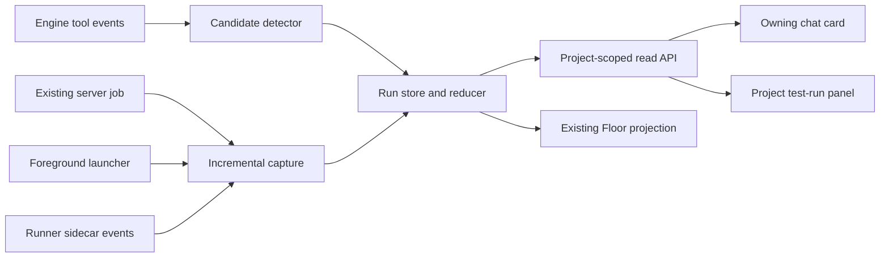

# Live test-run progress: design spike

Backlog: `c5721a97`. Author: Sol_Tobin. Date: 2026-11-05.
Source baseline: `c36cedad`, branch `clayrune/agent/2812147496d4`.
Status: proposal for Dave's decisions; no production changes or live verification.

## 1. Outcome and scope

An agent-started test run belongs to the conversation that launched it, even
after that conversation's turn ends. Its chat card shows progress, completed /
total units, pass / fail / skip counts, failing names as failures arrive,
estimated time remaining, and the final verdict. Its Floor figure shows
`testing 42%`. Runs without an owning conversation appear at project level.
This applies to every project and to Claude, Codex, Gemini and Qwen; none of
these surfaces is a terminal pop-out.

**The architectural recommendation is a shared launch/capture protocol plus
runner adapters. Vendor tool streams are supplementary discovery, not the live
progress transport.** This recommendation has not been selected; section 9
contains the choices Dave must settle.

There are two separate coverage problems:

1. Capture: a process must emit observable events while it runs. Merely seeing
   an agent ask its CLI to run a command does not provide its stdout live.
2. Measurement: a runner must declare its unit count and outcomes. An arbitrary
   script cannot supply a truthful assertion total unless instrumented.

Consequently a card can always describe an enrolled run's lifecycle, but a
determinate percentage is conditional on an announced total. Unknown totals
remain unknown; no time-based invented percentage or inferred passing tests.
Full "any agent-started run" coverage is an acceptance gate, not something
instruction text or a best-effort command regex can guarantee.

Out of scope: changing test selection or order, choosing another environment,
automatically rerunning failed tests, installing dependencies in user projects,
publishing results, changing execution permission, and replacing the in-flight
restart/rollover work. The design adds observation to authorized execution.

## 2. Verified seams in this checkout

These are current-code facts, not proposed API capabilities. Paths are relative
to the installation checkout so this document contains no operator-only paths.

| Existing path | Verified symbol / behavior | Design use |
| --- | --- | --- |
| `mc/agent_runtime.py` | `AgentEvent`, `EventType.TOOL_USE`, `EventType.TOOL_RESULT` | Normalized discovery input; not a test event bus. |
| `mc/agent_runtime.py` | `ClaudeRuntime.parse_event` | Preserves mixed text/tool content in `payload.blocks`; primary event follows the first block. Scan all blocks. |
| `mc/agent_runtime.py` | `CodexRuntime.parse_event` | `item.started` / `item.updated` command executions become tool-use events; completed executions carry `aggregated_output` as block `output` and exit code in `input`. Updates can repeat. |
| `mc/agent_runtime.py` | `GeminiRuntime.parse_event`, `GeminiRuntime._read_stream` | Tool names/parameters are normalized; result events carry ID/status. The reader correlates names and renders summaries. |
| `mc/agent_runtime.py` | `QwenRuntime.parse_event` | Tool blocks preserved; `user` tool-result envelopes deliberately return `None`. |
| `mc/agent_runtime.py` | `_mode_a_reader` | Shared reader has `on_raw_record` / `on_raw_eof` callbacks before formatting. Tool display only reads the first normalized block. |
| `mc/blueprints/agent_routes.py` | `_read_agent_stream`, `_read_agent_stream_b` | Claude Mode A/B readers; potential tiny observer calls before display. |
| `mc/background_tasks.py` | `note_tool_use`, `note_system_event`, `waiting_label`, `drain` | Claude lifecycle/task ownership and notification bookkeeping; not test counts or a stdout reporter. |
| `mc/agent_jobs.py` | `start_job`, `build_argv`, `public_job` | Shared subprocess job runner; writes merged stdout/stderr to a binary log; watcher waits for exit and invokes `on_complete`. No live progress callback today. |
| `mc/blueprints/agent_routes.py` | `agent_job_start`, `agent_job_status`, `_job_log_dir`, `_job_on_complete` | POST/GET job routes, process registration, owner/project checks and completion delivery. |
| `mc/clayrune_mcp/tools.py` | `_start_job`, `_job_status`, `TOOLS` | Existing `clayrune_start_job` / `clayrune_job_status` forward to the same HTTP job API using the caller's session. |
| `mc/long_job_guidance.py` | `long_job_note`, `job_route_url` | All-engine guidance for commands expected to exceed about five minutes. Guidance is not enforcement. |
| `mc/bg_job_liveness.py` | `parse_tool_result`, `holder_pids`, `liveness`, `file_stats` | Existing Claude output-file/PID evidence, useful for supplementary attachment; not a universal test observer. |
| `mc/blueprints/agent_routes.py` | `agent_stream` | `/api/project/<project_id>/agent/stream?session=...&since=...` emits output/activity/status and turn completion. |
| `static/js/resume-preview.js` | `connectAgentStream` | Browser EventSource handlers, including turn completion and stream teardown. |
| `static/js/conversation.js` | `appendAgentLine`, `fetchAgentStatus` | Live card mount hook and status reconciliation precedent. |
| `static/js/agent-read-card.js` | `agentReadMarkerId`, `mountAgentReadCards` | ID-only marker, authoritative fetch, live + cold-render mounting, window bridges. |
| `static/js/rich-text.js` | `formatAgentText` | Existing rich-text rendering; runner text must not enter this as instructions or executable card markup. |
| `static/index.html` | `refreshModalById` | Rebuild/mount boundary; extracted card must rehydrate here. |
| `mc/blueprints/floor_routes.py` | `wire`, `_figure_state`, `_figure`, `_live_sessions`, `floor` | `/api/floor` projects session activity and rooms; asks outrank work. Current poll hint is five seconds. |
| `static/js/floor.js` | `_floorLine` | Renders working/idle/asking descriptions; currently has no test-run projection. |
| `mc/caller_attribution.py` | `attribute_caller`, `managed_roots` | OS-derived caller/session evidence, preferable to trusting request-body session claims. Availability can degrade; not a universal authentication guarantee. |
| `tools/pytest-watch.py` | `read_progress` | Existing local regex watcher for pytest count-style logs. Re-reads the whole file, recognizes counts/failure marks; no chat ownership or reliable per-failure names. |
| `tools/smoke/package.json` | `scripts.test` | Explicit `node ...mjs && node ...mjs` sequence, dependency is `playwright`, not a Playwright Test suite. |
| `tools/smoke/desk.mjs`, `tools/smoke/boot-smoke.mjs`, `tools/smoke/floor-poll-survives-error.mjs` | Standalone scripts, custom console messages and process exit | A Playwright Test reporter cannot observe their internal assertions automatically. |
| `mc/dev_harness_runner.py` | `_execute` | Calls `start_job(direct_argv=...)` with its own output capture policy. Progress must not enable output suppressed by that path. |
| `installer/build-macos.spec` | `datas` | New external reporter assets need explicit packaging. Source-checkout success alone proves no shipped-asset coverage. |

The inspected job POST is
`/api/project/<project_id>/agent/<session_id>/job`; status GET appends
`/<job_id>`. It defaults cwd through `_session_cwd`, validates shell/cwd and
timeout, registers the child, and refuses incognito sessions (400), sandboxed
Codex unattended sessions (403), and commands refused by the unattended fence.
The corresponding MCP tools preserve these refusals.

This baseline's `_jobs` dictionary and watcher threads are in memory.
Server-owned jobs are outside the agent CLI's process tree and can survive a
CLI rollover; this does **not** establish server-restart survival. The
in-flight design in `docs/AGENT_SURVIVE_RESTART_DESIGN.md`, section 10, proposes
persisted adoption. Rebase and recheck its landed contract before integration.

## 3. Detection and capture, by engine

| Engine | What can identify a direct test command today | What is missing for reliable live progress | Proposed integration |
| --- | --- | --- | --- |
| Claude | Bash/PowerShell tool input in assistant blocks; Mode B system task events in `background_tasks.py`; some tool-result output-file evidence | Foreground stdout is not a universal streaming feed. Background task start/end does not enumerate test results. | Observe every tool block in both Claude readers. Correlate task/tool IDs; enroll launcher's events or attach a validated existing output file. |
| Codex | `command_execution` start/update/completed events normalized by `CodexRuntime.parse_event` | Completion includes aggregated output; start/update does not establish a live byte stream. Nested tool orchestration may hide the actual shell command. | Passive observer via shared raw-record callback; dedupe by item ID/attempt. Wrapper/job owns live progress independently. |
| Gemini | `tool_use` name/parameters and `tool_result` ID/status | Result normalization supplies no general incremental stdout; bespoke reader differs from shared Mode A reader. | Tiny observer in `GeminiRuntime._read_stream`; forward complete blocks to the shared detector. No separate progress store. |
| Qwen | Claude-shaped assistant tool blocks in `QwenRuntime.parse_event` | User tool-result envelopes are suppressed, so normalized events cannot establish every exit or per-test result. | Shared raw-record callback can observe envelopes before suppression; wrapper/job remains the live path. |

None of the four tool streams alone fulfills the request. Do not derive
progress from model prose, a shell preview truncated for display, the outer
agent's exit code, or a printed percentage in arbitrary output.

### Shared capture contract (proposed; Q1 and Q4)

Use one run protocol for both execution paths:

- **Server-owned job:** enroll a recognized test command inside the existing
  job start path and observe its existing log while the process runs. A new
  leaf observer tails incrementally with byte offset and partial-line state;
  do not replace the log file with a blocking pipe or wait until `_tail` runs
  on completion. At process exit, drain remaining bytes before finalization.
  `start_job` and `_job_on_complete` retain execution and wake ownership.
- **Foreground/native tool:** a portable launcher, conceptually
  `python <installation>/tools/test-run.py -- <exact argv>`, runs inside the
  caller's execution environment, tees output and publishes the same run
  events. It is a child of the original tool, inherits its sandbox/permissions,
  and does not ask the server to execute an unsandboxed replacement. Support
  explicit shell mode only when the original command requires shell syntax.
  A Python launcher requires an available interpreter; select the project's
  interpreter for pytest and prove the packaged launch entry on every OS.

The existing HTTP job route is **vendor-neutral**, and the wrapper/event
protocol is also vendor-neutral. Neither depends on the model understanding
pytest output. Both derive installation paths from Clayrune and cwd from the
actual project/worktree. Never assume the target project imports `mc`, uses
this repository's venv, or contains `tools/smoke`.

The job route does not currently inject reporters. A job carrying the launcher
or an explicit runner manifest can enroll structured reporting; a merely
recognized command without that instrumentation gets a provisional,
indeterminate card and best-effort log parsing. Do not advertise the latter as
equivalent coverage. Output buffering may also delay console diagnostics;
flushed reporter sidecars are independent of that buffering.

Enrollment records project, stable MC session ID if present, launch turn
identity, cwd, process identity and a run ID **before** reporter events arrive.
For job launches derive owner from validated job/session state. For foreground
launches use managed process ancestry plus a scoped enrollment receipt; a body
field, env var, test name or stdout marker cannot assign a run to another
conversation. Registration failure must not silently erase coverage: keep the
original command result, display a capture diagnostic when possible, and record
the run as incompletely observed. Immediately register owned child processes
with the existing Process Manager; progress ingestion cannot create or kill
processes.

The passive detector recognizes direct `pytest`, `python -m pytest`, known
Node test commands and configured script entry points. It does not evaluate
shell code, change quoting, expand globs early or rewrite arbitrary npm scripts.
For `cd ... && pytest ...`, pipelines, aliases, redirection, nested scripts and
shell functions, preserve the exact original command and require explicit
launcher metadata when classification is uncertain. Recognizing `npm test`
does not prove that it runs tests. A server job shell exiting 0 after `pytest;
echo done` does not prove that pytest passed.

Deduplicate job, wrapper and tool observations with run/launch IDs. A repeated
identical command is a new attempt, not the same run. One shell that launches
multiple suites has an explicit parent run and child run IDs. Never count
parent script completions and child test completions in the same denominator.

**Coverage boundary:** passive discovery cannot catch every opaque wrapper or
nested tool on its own. Requiring the launcher for every agent test command
needs adoption/enforcement at all supported launch surfaces; prompt guidance
alone is insufficient. Restricted foreground capture needs a filesystem spool
inside the permitted workspace if loopback HTTP is inaccessible, registered
for read-only observation without expanding sandbox access. Incognito capture
must avoid persistent metadata/spools or remain explicitly unsupported until
that is implemented. Q4 is a delivery decision, not permission to remove the
existing job refusals.

## 4. Reporters and truthful progress

### Pytest

Propose a stdlib-only plugin loaded explicitly for the target project's pytest
process, without editing its conftest, test files, dependency lock or global
plugin configuration. Ship the plugin as a standalone asset; scoped
`PYTHONPATH`/`-p` injection must preserve the target interpreter, existing
environment and supplied test arguments. Do not add a preliminary collection
run: collection can have effects and its results may differ from the real run.

Verify these hooks against each supported pytest version during implementation.
Their existence was checked against installed pytest 9.1.1 for this spike:

- `pytest_collection_finish`: selected item count for serial runs, after
  deselection. Before it arrives show `collecting`, with unknown total.
- `pytest_deselected`: separate deselected count, never completed tests.
- `pytest_collectreport`: collection skips/errors, separately from test counts.
- `pytest_runtest_logreport`: node ID, phase, outcome, duration and xfail detail.
  Emit a failing name immediately on a failed setup/call/teardown report; count
  a logical test completed once after its phases finish. A passing call with
  failed teardown is not a passed test. Track retries/attempts explicitly.
- `pytest_sessionfinish`: reporter exit status and final collection/accounting
  snapshot. Finalize only after the launcher observes the actual process exit,
  including errors in later plugin cleanup.

Write versioned events to a dedicated per-run sidecar, flushed per event;
stdout remains the user's existing stdout. Append in bounded records. For
xdist use separate worker spools and a controller aggregation path, not many
processes racing to append one file; publish one agreed selected total, dedupe
by logical node ID/attempt/worker, and handle crashed workers and reruns. Until
that adapter is proven, retain known failure events but mark distributed counts
partial rather than silently treating worker collections as independent totals.

Expose pass, fail, skip, error, xfail and xpass separately. Collection errors
are not extra completed tests. Exit codes such as interrupted, internal error,
usage error and no-tests-collected get explicit final reasons. Strict xpass
follows pytest's actual outcome. With `-x`/maxfail, show e.g. `failed, 18/200
completed, stopped early`, not 100% of the originally selected tests.

### Node and system smokes (Q2)

For native `node --test` or Playwright Test projects, use separate framework
adapters behind the same protocol (their actual supported reporter contracts
need version checks in their build units). This repository's `tools/smoke/*.mjs`
instead import the `playwright` browser library and run custom assertions.
Attaching a Playwright Test reporter would report none of those assertions.

For these scripts an explicit launcher manifest declares the ordered scripts
actually requested; emit script-start/script-end and name failures by script.
Show `unit=script`, e.g. `3/12 smoke scripts`, with per-script pass/fail/skip.
Fail-fast `&&` means remaining scripts were **not run**, not skipped. Preserve
the requested order and stop/continue policy. Do not turn an opaque `npm test`
string into a guessed new test plan.

Assertion-level names/skip counts require an explicit checkpoint emitter in
each smoke's existing `ok`/`fail` helpers and a declared total, or migration to
a framework. Console lines such as `ALL PASS`, `OKAY`, `FAIL` and emoji checks
vary across scripts and may include fixture content. They are diagnostic text,
not an authoritative assertion protocol. A single standalone script initially
has total 1 script; its internal assertion total remains unknown. Q2 determines
whether this staged fidelity is acceptable.

### Generic fallback

Every enrolled unknown runner gets start, elapsed time, last-output age, process
identity, captured failure diagnostics and final process verdict. Render an
indeterminate bar, `done/total unknown`, unknown counts as dashes, and no ETA.
A reported runner summary may fill verified fields with a lower-confidence
`parsed` source label. Reuse the ideas from `tools/pytest-watch.py`, not its
full-file polling loop or its assumption that a console summary proves exit.
Never fabricate failing names or pass/skip counts from an exit status.

Reporter/capture failure is independent of test failure: `exit 0, progress
incomplete` is possible; so is `exit 1, failure names unavailable`. A missing
reporter is visible. A process that disappeared without an authoritative exit
record is `lost`, never green.

Keep capture off the test process's critical path with bounded queues/batches.
If telemetry overflows, retain authoritative counters/final snapshot and mark
detail loss visibly. Do not silently truncate failure names into apparent
completeness; expose total failures and page the retained detail. Compose
existing reader callbacks rather than replacing them. In particular,
`_mode_a_reader` treats raw-callback failure as capture failure for the agent;
the progress observer must catch its own transport errors, log them and mark
telemetry degraded without changing the command's or agent's exit verdict.

## 5. Proposed run/event contract and persistence

The following fields and routes do not exist yet.

Run snapshot:

```json
{
  "schema": 1,
  "run_id": "opaque-server-id",
  "project_id": "owning-project",
  "owner_session_id": "stable-mc-session-id-or-null",
  "owner_turn_id": "launch-identity-or-null",
  "job_id": "job-id-or-null",
  "parent_run_id": null,
  "source": "job",
  "runner": "pytest",
  "unit": "test",
  "state": "running",
  "seq": 41,
  "selected_total": 100,
  "completed": 42,
  "counts": {"pass": 40, "fail": 1, "skip": 1, "error": 0, "xfail": 0, "xpass": 0},
  "collection_errors": 0,
  "percent": 42,
  "eta_seconds": 18,
  "capture": "complete",
  "latest_failures": [{"name": "tests/test_demo.py::test_case", "phase": "call"}],
  "exit_code": null
}
```

Also retain timestamps, cwd/target identity, redacted display label, process
creation identity, reporter version, event source IDs, total revision,
not-run/deselected counts, failure pagination metadata and telemetry health.
The illustration uses nullable fields; actual JSON uses null, not the example
strings describing null alternatives.

Events: `run_started`, `collection`, `unit_started`, `unit_report`,
`diagnostic`, `heartbeat`, `run_finished`. Every event includes schema/run ID,
producer ID, producer sequence and observation timestamp. A store reducer
assigns the canonical monotonically increasing snapshot `seq`, rejects
duplicates and illegal terminal transitions, and tolerates chunk splits and
replayed output. Producer dedupe must not confuse a real retry with a replay.
Finished states distinguish passed, failed, error, cancelled, timeout, no tests
and lost. A runner-finished event alone cannot mint process success.

Percentage is completed / selected total for a fixed set and unit. When all
units finish but process cleanup is pending, say `100% tests completed,
finalizing`; success waits for exit. If totals change, increment total revision
and explain the recalculation. Do not silently force a monotonic percentage
over a changing denominator. With multiple concurrent suites, show individual
runs; a Floor aggregate combines only compatible known totals. Otherwise show
`testing, 2 runs` and unknown aggregate percent.

ETA is explicitly approximate, based on completed-unit timing after a minimum
sample (propose five units). Serial mode can use recent throughput; parallel
mode needs wall-clock throughput rather than summing worker durations. Clear
ETA on stale progress, denominator changes, unknown total or insufficient data.
Last-output age and last-test-completion age are separate: a long test is not
proven hung simply because no test finished recently.

Proposed storage is `Path(DATA_DIR).parent / 'test_runs'`, a sibling of project
records, **never** an unexcluded JSON under `data/projects/`. Persist canonical
events/snapshots atomically with flush/fsync before replace; bound event sizes,
diagnostic retention and list responses. Persist compact terminal summaries
for chat rehydration; initial engineering assumption is seven days of detailed
telemetry with compact summaries following owning-chat retention. This is a
tunable implementation default, not a selected product policy. Pruning must
not remove active runs or destroy the only record of a failure silently.

Redact command display labels; do not persist full env, credentials or arbitrary
stdout in telemetry. Keep bounded names/phase/error snippets and refer to the
existing authorized job log for detail. Reporter text is untrusted data:
escape it, never execute it or let it supply session identity or UI markup.
Incognito must use ephemeral in-memory capture without durable markers or
summaries; a restricted-mode implementation must prove its spool policy first.

On reconnect, read the canonical snapshot rather than replaying chat prose.
On server restart, resume tails from stored offsets only after validating the
original process identity and upstream job adoption evidence. Truncation or
rotation resets the source generation, not accumulated test results blindly.
Absent reliable adoption/exit evidence, mark observation stale/lost. Do not
claim this feature keeps jobs alive, kill unrelated processes, or duplicate
the supervisor being built elsewhere.

## 6. Event path to chat, Floor and project (Q3)



### Chat

Propose a new blueprint `mc/blueprints/test_run_routes.py` with:

- `GET /api/project/<project_id>/test-runs?session=<sid>&after=<cursor>`:
  paged snapshots for that conversation, plus active runs even when no new
  agent output exists. Omitting session returns the project's list, including
  ownerless runs. Cursor expiry requests a fresh snapshot, never loses state.
- `GET /api/project/<project_id>/test-runs/<run_id>`: authoritative detail and
  bounded/paged failure names. Missing or cross-project IDs return 404.
- Enrollment/event ingestion for launchers is a distinct write contract in
  the same new blueprint, with run-scoped authorization, size/sequence bounds
  and attributed owner binding. Final URI/auth transport is an implementation
  contract to review before enabling writes, not an already available route.
  It accepts telemetry only, never commands to execute.

Recommend one shared visible-page poll coordinator, roughly once per second
while displayed runs are active, backed off when quiet. Batch requests by
visible project/session set, allow one in-flight request per project, and share
data between mounted cards; never allocate a timer/connection per test. Cold
mount, visibility/focus restoration and full modal rebuild fetch immediately.
Pause hidden-page polling, resume from server truth, use abort/timeout and
bounded retries. Terminal run discovery must work even if start/end occurred
while the chat was closed.

When chat SSE is already open, a tiny `test_run` snapshot/change hint in
`agent_stream` and `connectAgentStream` can reduce latency. Hints use run `seq`,
independent of chat line indices; stale hints cannot overwrite newer polls.
They are optional acceleration. Do not keep idle chat SSE open for jobs or add
one SSE per run: existing connections close at turn completion to release the
browser's per-origin slots. Background tests can outlive that turn.

Use an ID-only `[test-run:<id>]` anchor, following `agent-read-card.js`, inserted
once by the server when the launch is enrolled. Hook live `appendAgentLine`,
cold conversation rendering and `refreshModalById` mounting. The new card
module uses window bridges because sibling scripts are ES modules. Markers
only locate server-owned records; typed fake markers cannot create a run.
The API list is the recovery path if old chat lines were trimmed or an anchor
was lost during a crash; restore exactly one mount per run ID per chat view.

Display label and unit, progress/elapsed/ETA, counts, failure names as they
arrive, telemetry freshness and a final verdict. Failure names may stream
before the test is finalized. Use text nodes/escaping, keyboard-accessible
failure expansion, an accessible progressbar with unknown-value semantics,
and restrained live-region announcements. Rebuilds and user scrolling must
not duplicate cards or force-scroll a reader away from older messages.

### Floor

Add a separate summary projection via proposed `mc/test_run_floor.py`, wired
into `floor_routes._figure` and `floor`. Keep `_figure_state`'s asking priority;
use a new `test_runs` field rather than overwriting `activity_state` or
pretending the model is executing a turn. A figure can be idle while its job
is testing. `_floorLine` delegates test wording to a new small frontend module:
`testing 42%`, `testing, collecting`, `testing, total unknown`, or `testing,
2 runs`. A pending human question remains the primary line; test progress is
still visible as secondary information.

`_live_sessions` currently includes only running/idle sessions. Completed or
temporarily absent owners with active tests need an explicit projection from
the run store; do not drop their tests because a one-shot engine exited.
Keep a linked figure while its known owner is displayable; if the owner is
unavailable, show `owner unavailable` at project level without transferring
ownership to a different active chat. No synthetic model activity is needed.

Rooms with ownerless/absent-owner active runs must become visible even with
zero ordinary figures, rather than staying in `quiet`. Attach project run
summaries to the existing `/api/floor` payload. Keep its five-second polling
cadence initially; this is a coarser view of the same store, not a second
counter. Terminal history stays in the chat/project panel without pinning a
figure as testing forever. Existing asking/working room sort semantics must
account for active testing when choosing room order.

### Project runs without a chat

A new project test-run panel lists active/recent runs, their launch source,
unit, counts and verdict using the same API/card data. Project-owned harness
or automation callers enroll through the same capture service with null owner;
do not invent an agent session to use the existing session-only job route.
Record the configured project/worktree identity at launch. Manual external
commands need explicit enrollment; do not scan unrelated OS processes or guess
their project from their command name. "Ownerless" means a registered run
with no conversation owner, not automatic discovery of everything on the host.

## 7. Build phases: one implementation module per unit

All paths below are **proposed new modules**, not claims that files exist.
Each phase owns one implementation module plus its focused tests/docs and,
where relevant, companion styles. Existing-file edits are wiring only: new
business logic stays outside monoliths. Land sequentially and run affected
smokes after each merge. No phase edits `mc/agent_shim*.py` or
`mc/midturn_rollover.py`; reconcile their exposed interfaces after they land.

| Phase | New module owned | Minimal existing wiring / acceptance |
| --- | --- | --- |
| 1 | `mc/test_run_store.py` | Event reducer, IDs, dedupe, snapshot persistence and replay. Validate torn writes, terminal invariants, retries, changing totals and cross-project isolation without launching processes. |
| 2 | `mc/test_run_capture.py` | Optional nonblocking observer hooks in `agent_jobs.start_job`. Dave's selected boundary: request final drain and wait at most 2 seconds before the existing callback; a late worker continues to finalization without a partial fallback. Preserve stdout policy, process registration, timeout and exactly-once completion. Test slow consumers, partial UTF-8, truncation, suppressed `direct_argv` and capture failure. Contract: `TEST_RUN_CAPTURE.md`. |
| 3 | `mc/test_run_ingest.py` | Owner binding, enrollment, scoped producer receipts, event validation, safe spool attachment and project-only ownership. No arbitrary file reads or process execution. Restricted-mode coverage depends on Q4. |
| 4 | `mc/blueprints/test_run_routes.py` | Register blueprint in `server.py`; expose read API and reviewed telemetry-only ingestion. Test project/session mismatch, paging/reconnect, forged ownership and authority parity. |
| 5 | `tools/test-run.py` | Portable foreground launcher and explicit composite manifest support; exact argv/shell/cwd/environment/exit propagation, stdout tee, registration and scoped telemetry. Wire guidance in `mc/long_job_guidance.py`; guidance alone does not close Q1. |
| 6 | `data/test_reporters/clayrune_pytest_progress.py` | Standalone serial plugin with separate `tools/test_run_pytest.py` launcher adapter; installation-derived loading and packaged source assets. xdist/retry aggregation remains explicitly unmeasured. Branch implementation, contract and delivery limits: `TEST_RUN_PYTEST.md`; no target imports of `mc`. |
| 7 | `data/test_reporters/smoke-progress.mjs` | Standalone lifecycle/checkpoint preload with separate `tools/test_run_node.py` adapter. Dave chose Q2 A: script units only, no existing helper migration. Actual wait owns script pass/fail; explicit manifest retains order and not-run remainder. Branch contract/verification limits: `TEST_RUN_NODE.md`. |
| 8 | `mc/test_run_detection.py` | Shared tool candidate observer. Tiny calls from Claude readers, shared Mode A raw callback composition and Gemini reader; scan all blocks. Dedupe wrapper/job/tool identities, handle old/new Codex envelopes and Qwen suppression. Never rewrite or rerun commands. |
| 9 | `static/js/test-run-data.js` | Shared poll/cache/sequence reconciliation; tiny SSE hint bridge in `static/js/resume-preview.js`. Prove updates continue after idle/turn end and across mobile suspension, with no per-run SSE connections. |
| 10 | `static/js/test-run-card.js` | Mount/live/cold hooks in `static/js/conversation.js` and `static/index.html`; ID anchors, accessible bar and failure list, companion stylesheet. Test repeated rebuild, inactive tab reopen, malicious names, unknown total and no duplicate cards. |
| 11 | `mc/test_run_floor.py` | Pure server projections; minimal wiring in `mc/blueprints/floor_routes.py`. Test idle owner, ended owner, asking precedence, compatible/incompatible concurrent totals, ownerless room visibility and terminal cleanup. |
| 12 | `static/js/test-run-floor.js` | Small rendering hooks in `static/js/floor.js`; testing line/badge and project room summary. Existing poll/error recovery remains intact. |
| 13 | `static/js/project-test-runs.js` | Separate project panel wired into project modal navigation; ownerless/recent runs from the same API. Test two projects/two sessions with the same test names and a project with no live figures. |

Optional native Node Test and Playwright Test reporters each get their own
module/build unit, rather than adding framework-specific bodies to the smoke
emitter. Their implementation is needed to claim measured framework counts in
projects using those runners; otherwise those runs use the generic fallback.

Phases 1-4 create a dark backend. Phases 5-8 establish capture coverage;
phases 9-13 deliver the requested surfaces. This is not shipped after backend
capture alone, or after a card mockup. Estimates in section 9 are incremental
engineering effort for those choices, overlap these phases, and are not
additive delivery commitments.

## 8. Verification and handoff gates

Implementation acceptance matrix:

1. Claude, Codex, Gemini and Qwen each launch both a foreground wrapper run and
   a server job from two different managed projects, including an external
   fixture project with no `mc` package. Verify exact owner, worktree cwd,
   environment, command selection and real process exit. Include direct tool
   commands that bypass the launcher: disclose the capture gap rather than
   passing a narrower matrix as universal coverage.
2. Pytest fixtures exercise collecting, deselection, pass/fail/skip, setup and
   teardown failure, xfail/xpass, no tests, maxfail, interruption, reporter
   failure, late exit failure, xdist, worker crash and retries. Duplicate and
   out-of-order producer events cannot inflate counters. A slow-running test
   does not produce an invented ETA or stuck verdict.
3. Node fixtures exercise this repo's standalone smokes and an external
   project's scripts. Assert script versus assertion labels, not-run versus
   skip, nested suites and immediate named failures where instrumented.
4. Browser checks at desktop and mobile widths cover live updates, background
   owner with idle/ended agent turn, chat reopen, trimmed anchors, modal rebuild,
   SSE disconnect, hidden/resumed tab, multiple runs, ownerless project and
   Floor asking precedence. Final verdict cannot depend on a model follow-up.
5. Preserve existing refusal/permission behavior. Test incognito and sandboxed
   foreground capture separately if Q4=A; server job rejection remains. A
   reporter cannot execute commands, claim another project or reveal suppressed
   harness output. Exercise caller-attribution failure explicitly.
6. Restart/recovery checks consume the landed restart owner's manifest/adoption
   contract; no supervisor edits here. Test observer restart during a run,
   completion while disconnected, PID reuse and missing exit evidence. Do not
   advertise process-restart survival based on persisted telemetry alone.
7. Run relevant existing regressions including `tests/test_agent_jobs.py`,
   `tests/test_background_job_endpoint.py`, `tests/test_floor_routes.py`,
   `tests/test_clayrune_mcp_tools.py`, and the new focused tests. New `mc/`
   modules pass pyright basic. For frontend wiring run boot, stream-dedupe,
   Floor recovery and new progress smokes after each merge. Use the main
   checkout's existing smoke dependencies in worktrees; do not reinstall them.
8. Verify bundled launcher/reporter assets from a clean installation and use
   an unrelated project interpreter; missing assets give a visible capture
   diagnostic. Add user guidance only once behavior exists; update changelog
   and user guide with actual delivered coverage and limitations.

Spike verification completed: inspected every existing path/symbol in section
2, both job routes, normalized/raw reader seams, chat stream/mount hooks,
Floor fields and standalone smoke structure. Checked local pytest hook names
without executing tests. No feature code, test suite, UI feature, authenticated
session, server restart or deployment was exercised by this documentation-only
spike. These gates are future work, not test results for this design.

Recovery plan/checkpoint: inspect source seams; specify the protocol and
surfaces; record undecided choices; validate source references and diff; commit
only this design on the assigned branch. The required separate plan write to
the home `.claude/plans/` directory was rejected by the unattended fence as
out-of-project global configuration. It was not retried; this paragraph keeps
the checkpoint with the deliverable. No merge/push/deploy is part of this task.

## 9. OPEN QUESTIONS

These are the original spike options. Dave subsequently selected A/A/A/B
(launcher adoption, scripts first, shared polling, restricted capture deferred),
recorded at the top of the MC-1148 journal. Phase 7 follows Q2 A without helper
migration. Costs below are the original rough engineering-day estimates,
including focused verification, not measured timings.

1. **Coverage:** A) mandate launcher adoption (5-8 days); B) observe vendor streams (2-3 days, live gaps). Recommend A; universal coverage needs verified adoption.
2. **Smoke units:** A) scripts first (1-2 days); B) named assertions immediately (4-7 days plus migrations). Recommend A; label script counts explicitly.
3. **Delivery:** A) shared polling plus existing SSE hints (1-2 days); B) project SSE (2-4 days, connection/replay work). Recommend A.
4. **Restricted modes:** A) sandboxed foreground capture and ephemeral incognito cards (3-5 days); B) defer (0.5 day, incomplete coverage). Recommend A; preserve job refusals.
